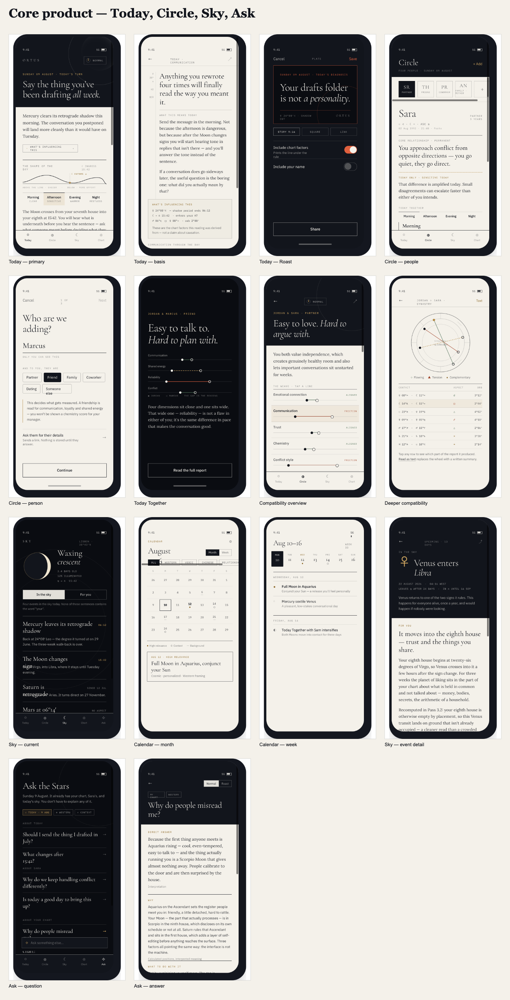
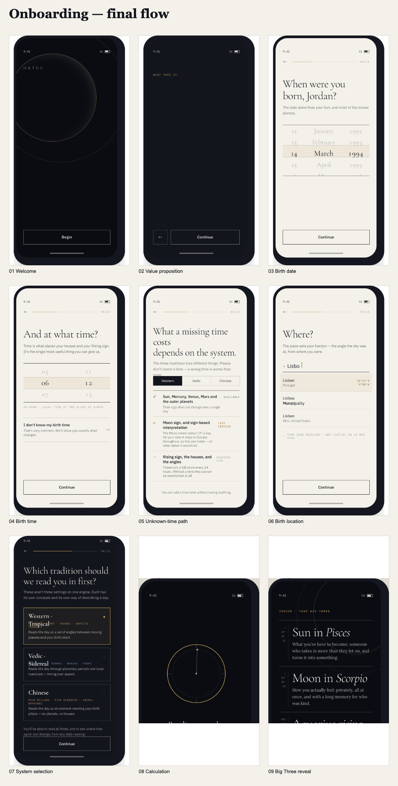
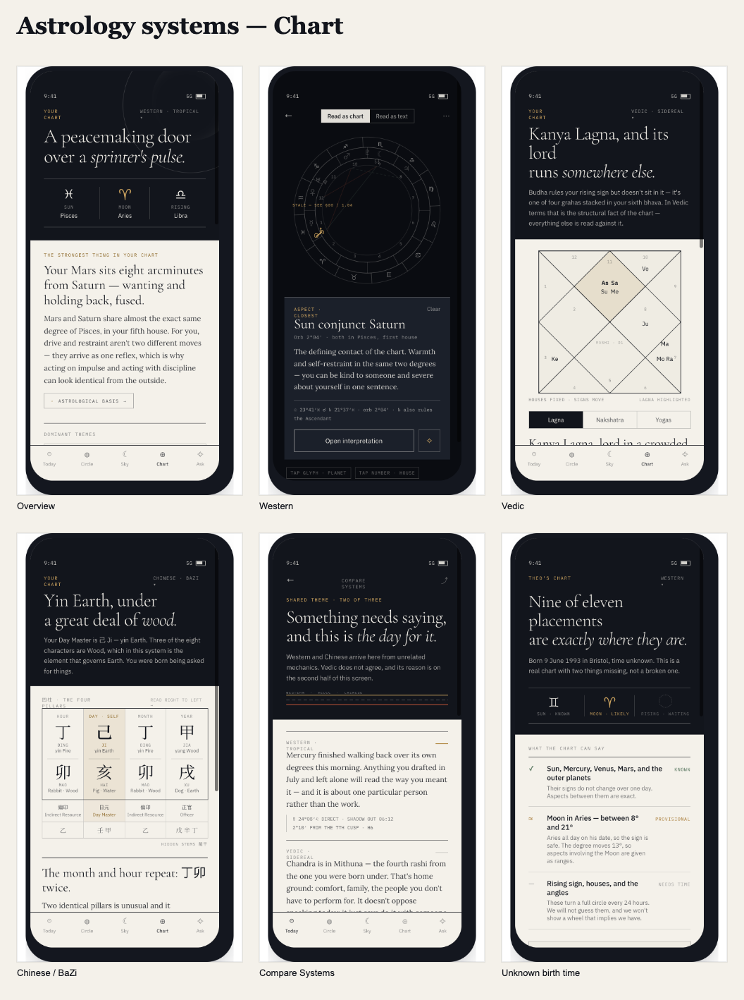
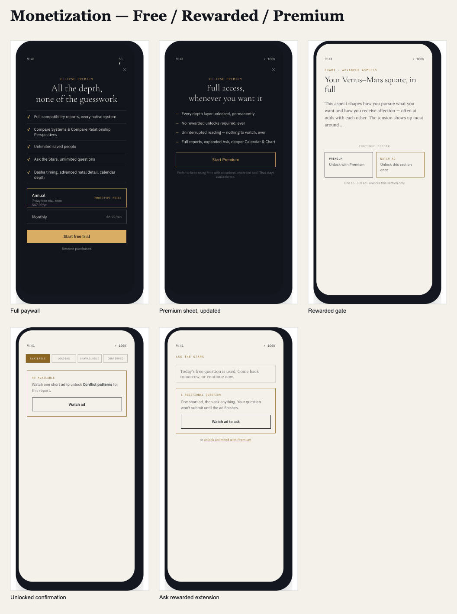
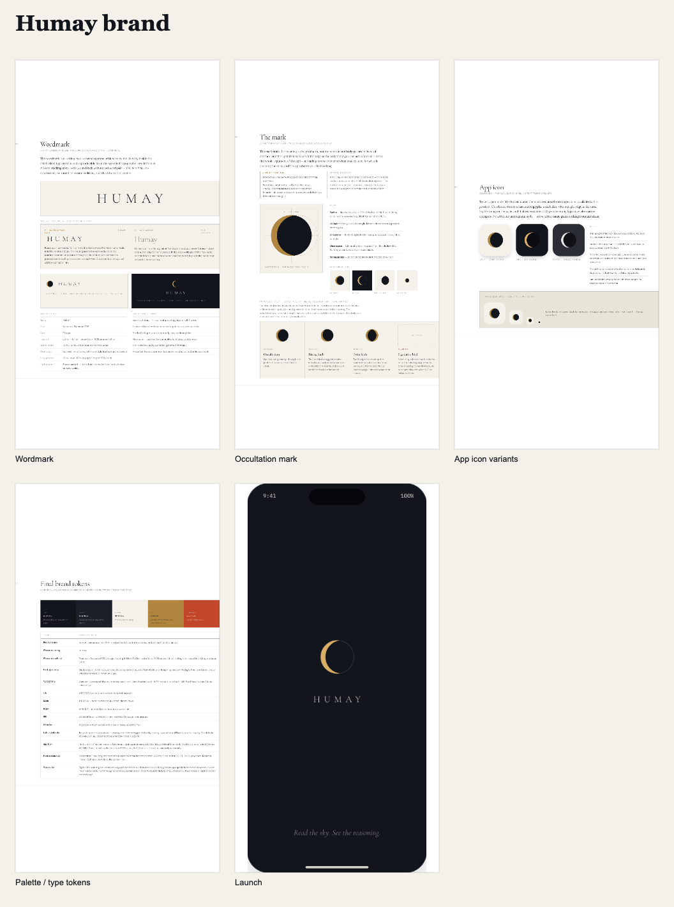

# Humay Final Design Archive

GitHub-friendly derived reference generated from the frozen Humay design artifacts.

This archive exists for **visual browsing, implementation reference and searchability**. It does **not** supersede the original `.dc.html` artifacts or [`../DESIGN_AUTHORITY.md`](../DESIGN_AUTHORITY.md). When a screenshot or Markdown summary conflicts with the authority map, the authority map and the applicable source artifact win.

## Archive contents

- **51 PNG files** — 46 individual/reference captures plus 5 overview contact sheets.
- **9 Markdown reference files** — concise, implementation-oriented summaries.
- Source design freeze: **Pass 6.1 — Final Engineering Freeze**.

## Visual overview

### Core product

### Onboarding

### Astrology systems

### Monetization

### Humay brand

## Reference documents

- [Product strategy](reference/product-strategy.md)
- [Onboarding](reference/onboarding.md)
- [Today & Circle](reference/today-circle.md)
- [Sky, Chart & astrology systems](reference/sky-chart-systems.md)
- [Ask the Stars](reference/ask.md)
- [Product completion / Settings / sharing / widgets](reference/product-completion.md)
- [Monetization](reference/monetization.md)
- [Humay brand](reference/humay-brand.md)
- [Engineering handoff & final freeze](reference/engineering-handoff.md)

## Browse PNGs by area

- [Onboarding](previews/onboarding/)
- [Today](previews/today/)
- [Circle](previews/circle/)
- [Sky](previews/sky/)
- [Chart / systems](previews/chart/)
- [Ask](previews/ask/)
- [Settings](previews/settings/)
- [Monetization](previews/monetization/)
- [Brand](previews/brand/)
- [Sharing / widgets / states](previews/sharing-widgets/)
- [Overview contact sheets](previews/overviews/)

## Known visual exception

`previews/settings/settings-03-notifications.png` is the closest layout capture from Pass 4 and predates the final Pass 6 notification ruling. It still shows the superseded Normal/Roast notification control. **Do not implement that toggle. Notifications are always Normal; Roast remains in-app only.** See [`reference/product-completion.md`](reference/product-completion.md) and [`../DESIGN_AUTHORITY.md`](../DESIGN_AUTHORITY.md).

## Methodology caveat

Screens showing Chinese/BaZi, advanced Luck Cycles, Western composite concepts, Vedic non-romantic compatibility or cross-system timing are visual/product references only where methodology remains unresolved. The archive never validates the sample astrology shown inside a mockup.

> **Prototype astrology values shown in design artifacts are illustrative only and must not be used as engineering fixtures. Deterministic astrology engines and validated outputs are the source of truth.**
