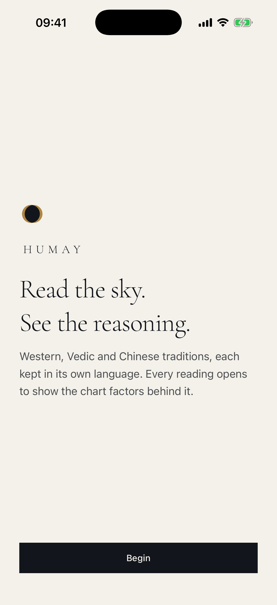
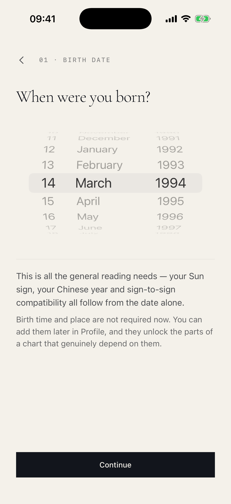
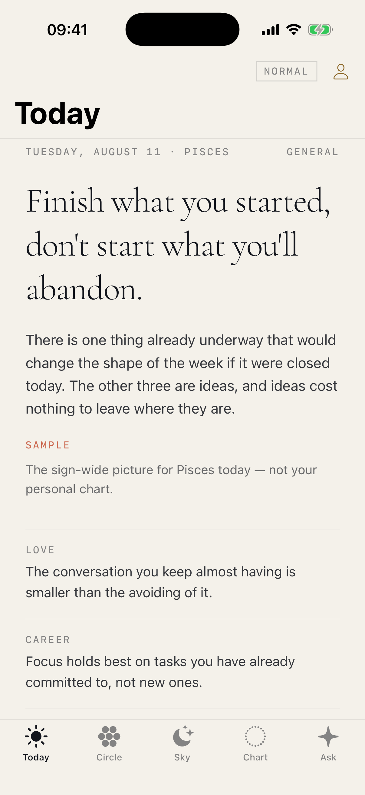
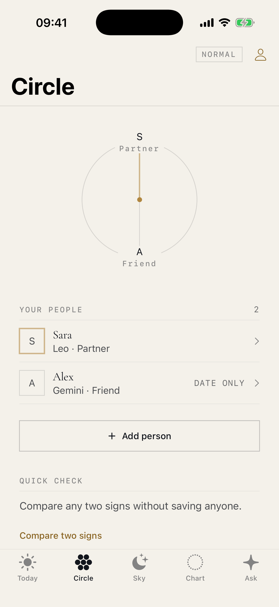
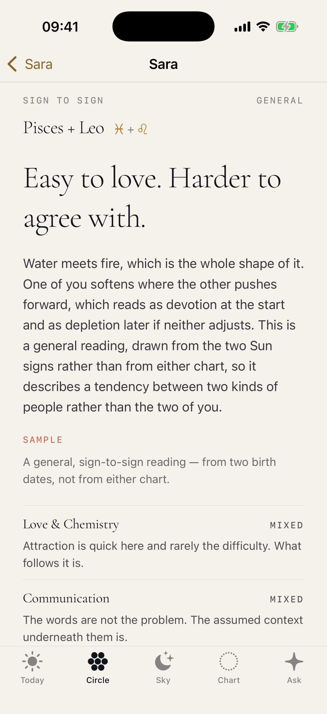
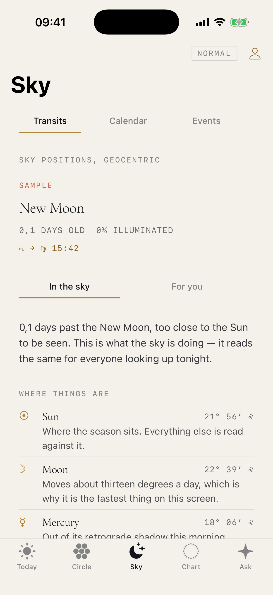
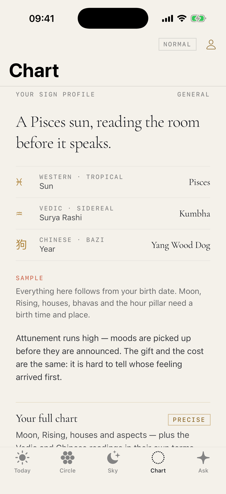
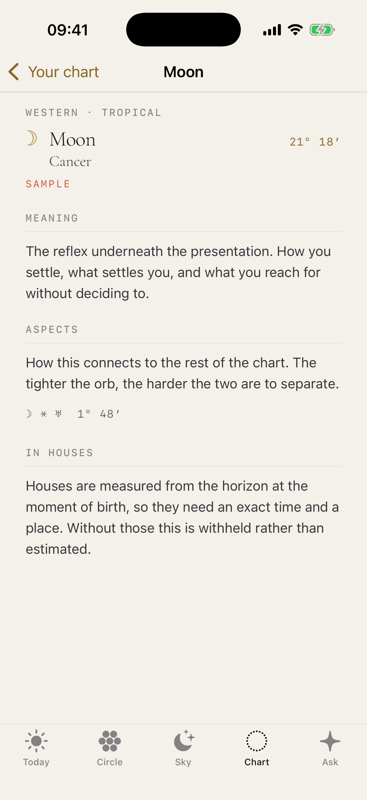
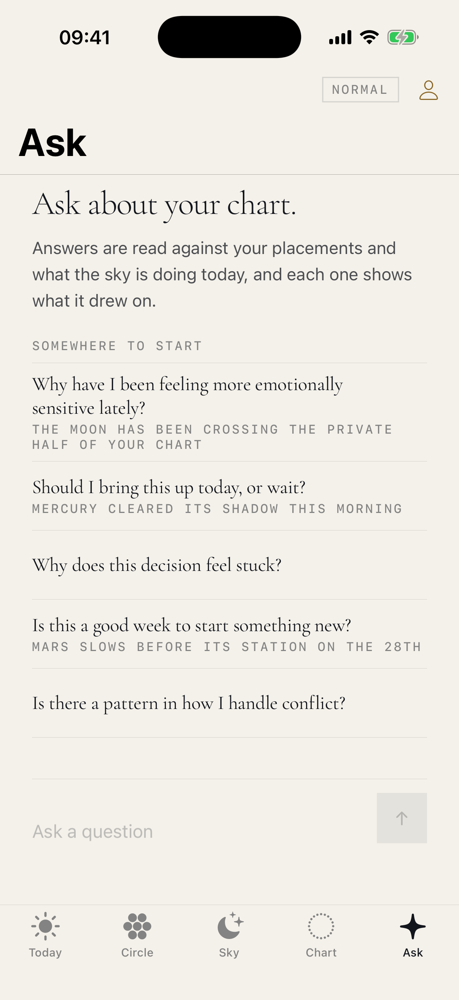
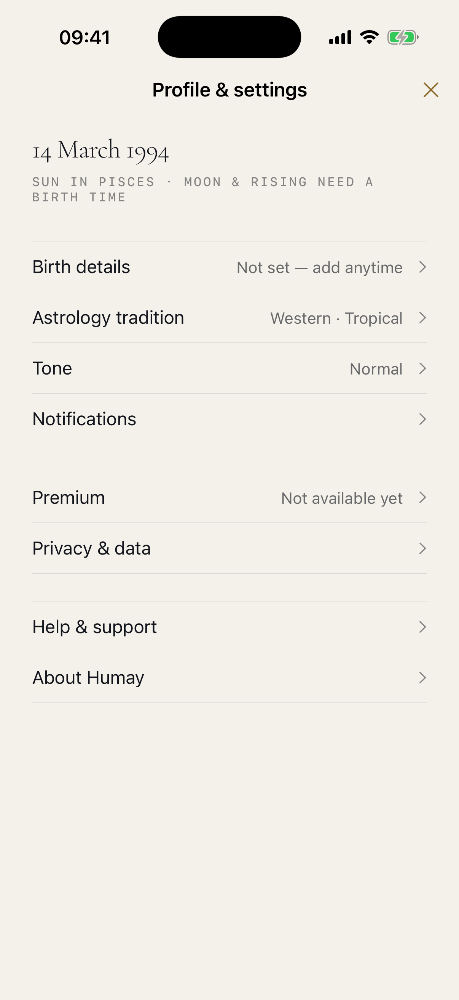

# Implementation Review Screenshots

Captured from the running application after the Phase 01M visual reconciliation and accessibility pass, 2026-08-11.

**Device:** iPhone 17 Pro simulator · iOS 18 · portrait · default Dynamic Type.
**Build:** Debug, mock content only.

## What these are, and are not

- A **record of what was built**, so the implementation can be reviewed visually against [`../MINIMAL_DESIGN_DIRECTION.md`](../MINIMAL_DESIGN_DIRECTION.md).
- **Not a specification.** Where a screenshot and the design direction disagree, the direction wins and the screenshot is the defect.
- **Not astrology.** Every value on these screens is mock fixture content. The `SAMPLE` marker in the captures is the development build saying so.

## The screens

| | Screen |
|---|---|
|  | **01 — Welcome.** Occultation mark, wordmark, the two-line promise. One primary action. |
|  | **02 — Birth date.** The only required input, with what it does and does not buy. |
|  | **03 — Today.** Kicker, editorial headline, overview, disclosed basis, four categories. |
|  | **04 — Circle.** The drawing, then the same people as a list. |
|  | **05 — Compatibility.** Four qualitative axes. No score anywhere. |
|  | **06 — Sky.** Underlined segments, the Moon first, "in the sky" against "for you". |
|  | **07 — Chart.** The three traditions, each in its own vocabulary. |
|  | **08 — Placement detail.** Placement, sign and degree, then meaning, aspects, houses. |
|  | **09 — Ask.** Suggested questions and a composer. No chat bubbles. |
|  | **10 — Profile & settings.** A cover from the header, not a sixth tab. |

## Also verified, not captured here

- iPhone SE (3rd generation) and iPhone 17 Pro Max, portrait.
- Default, largest standard and largest accessibility Dynamic Type on every screen above.
- Precise Today, Add person, Person detail, Precise compatibility, Quick check, Sky calendar, Sky event, the Western/Vedic/Chinese chart sections, the glossary sheet, and every settings page.
